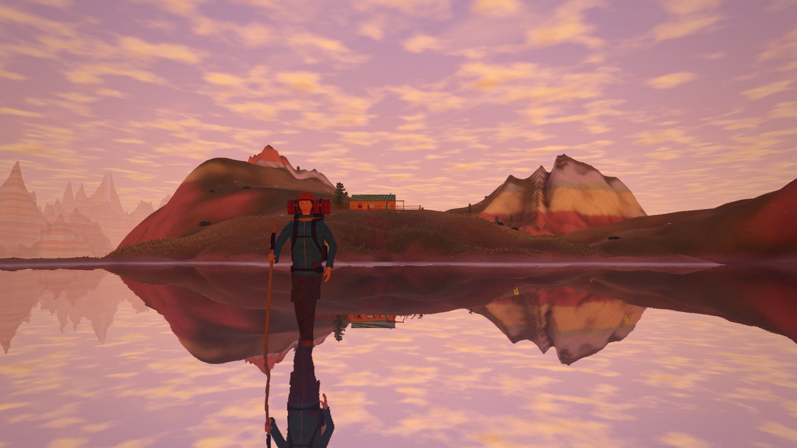
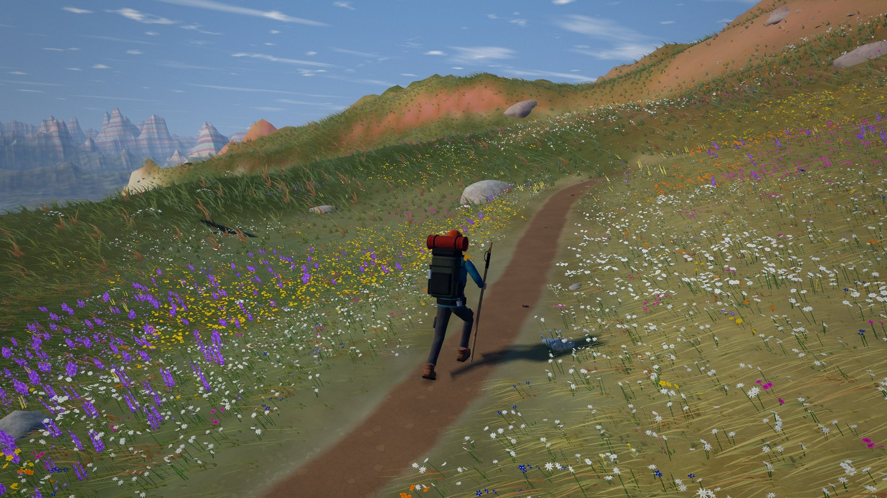
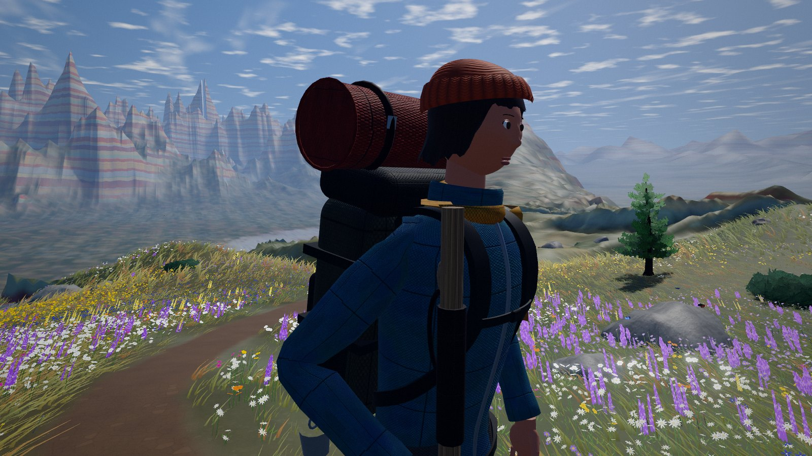
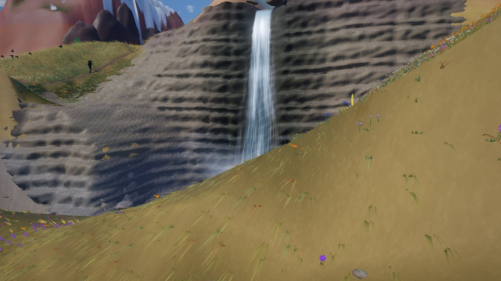
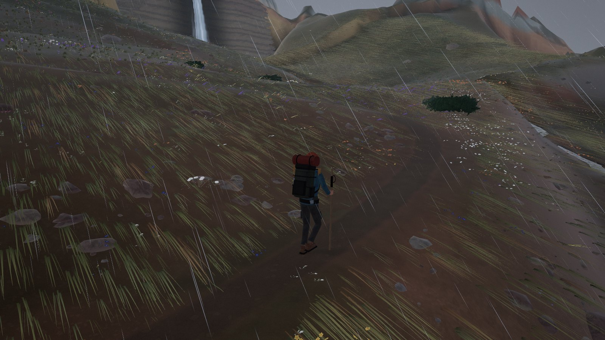
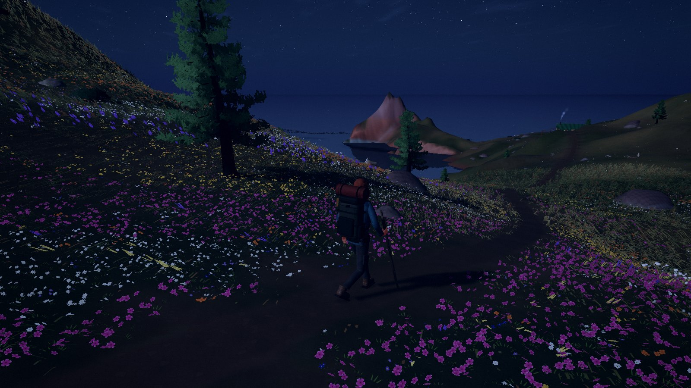
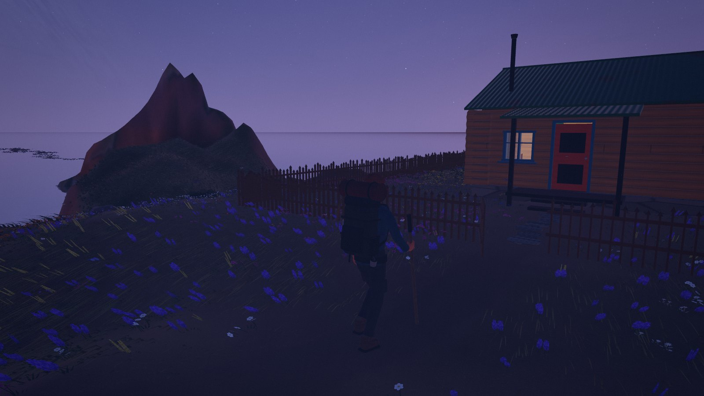
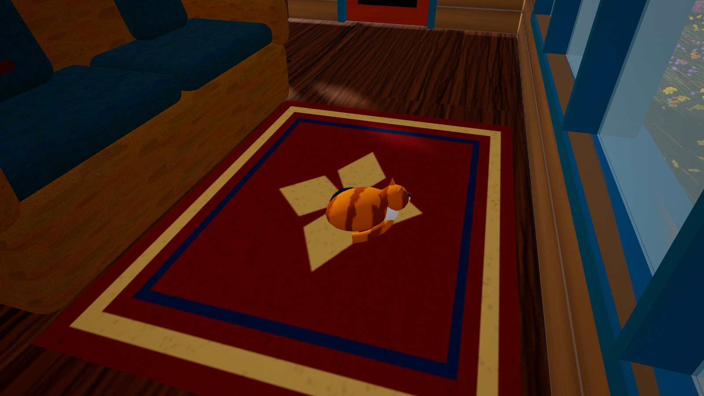
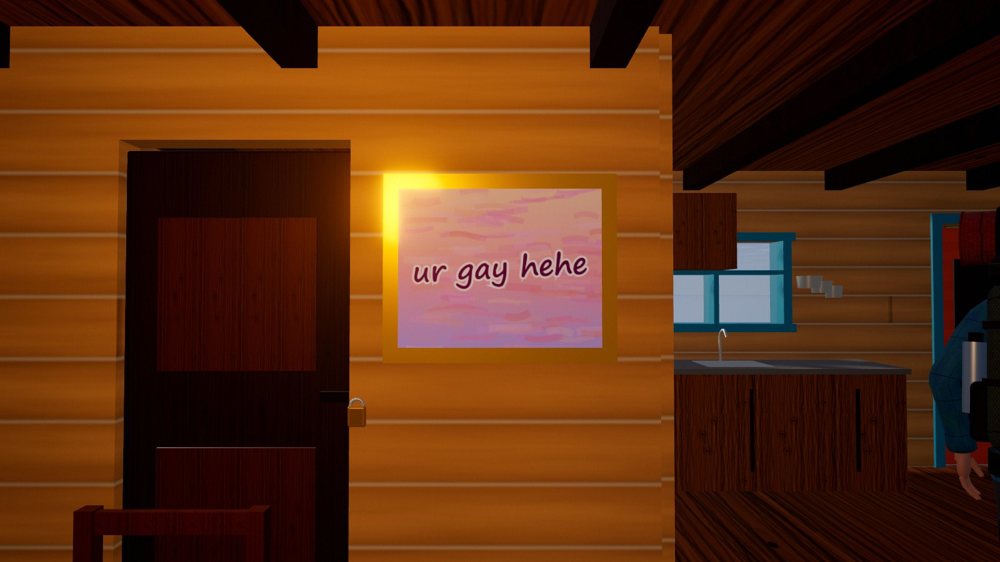

<div align="center">

# 🏔️ hike-m

**a little hiker, a very long walk, and a lake that turns into the sky**

*a 3D hike through Mongolia's rainbow mountains, made entirely in code, in one HTML file*



</div>

---

## ✨ what is this?

A tiny hiker with a big backpack sets off along a ridge trail through the striped rainbow mountains of Mongolia in late summer. The day goes by while they walk: a soft dawn, flowery mornings, a sudden afternoon squall, golden hour, and a starry night with the moon lighting the way.

The trail winds past a glacial tarn with fish in it, a big waterfall, a stone ovoo with blue scarves, a log footbridge, and a herd of argali that bolts if you get too close. At the very end there's a cozy little cabin… and past the cabin, a lake so still it turns into the sky. 🪞

Everything you see and hear is generated in code: the mountains, trees, flowers, animals, water, weather, the hiker, even the wind and birdsong. There are no models, textures or sound files, and the page makes no network requests. It's all one ~1 MB HTML file.

## 🎒 how to play

1. download [`mongolia-ridge.html`](mongolia-ridge.html)
2. open it in a desktop browser with WebGL2 (Chrome, Edge or Firefox)
3. sit back and enjoy the walk, the hiker follows the trail on their own 🥾

| input | what it does |
| --- | --- |
| `W` `A` `S` `D` / arrow keys | take over and walk yourself (autopilot picks up again after a few idle seconds) |
| drag | look around |
| scroll | zoom in and out |
| hold `T`, `F` or `Space` | fast-forward time ⏩ |
| `M` | mute / unmute the sounds 🔇 |

## 🌄 things to find along the way

- 🌸 meadows of wildflowers that sway in the wind and part around your feet, with butterflies to match
- 🌲 larch groves and creeping junipers in the sheltered folds of the hills
- 🐐 argali, gazelles, marmots that dive into their burrows, and an eagle circling high above
- 🏞️ a glacial tarn with grayling, a clear stream over a stony bed, and a 24 m waterfall
- ⛈️ an afternoon squall with rain, wet rock and lightning
- 🌌 a starry night with the moon as your lamp
- 🏡 a cabin with a fenced yard, a swing set, a hot chocolate on the table, a sleepy orange cat, a mysterious locked door, and a painting with a very important message
- 🪞 the endless mirror lake at the end of the trail

## 📸 screenshots

| | |
| --- | --- |
|  |  |
|  |  |
|  |  |
|  |  |

## 🛠️ building it yourself

The page is built from the sources in `src/` with [three.js](https://threejs.org) and [esbuild](https://esbuild.github.io), then everything is inlined into a single file.

```bash
npm install
npm run build    # writes mongolia-ridge.html
npm run dev      # serves it at http://localhost:5173
```

<details>
<summary>🗺️ what lives in <code>src/</code></summary>

| file | what's inside |
| --- | --- |
| `world.js` | the terrain, trail, stream, waterfall, cabin pad and the endless lake |
| `terrain.js` | terrain shading: rock strata, grass, scree, the trail and stream beds |
| `field.js` | the grass and wildflowers that follow the camera |
| `trees.js`, `veg.js`, `rocks.js` | larches, junipers, shrubs and boulders |
| `water.js` | the tarn, stream, plunge pool, waterfall, mist and mirror lake |
| `hiker.js`, `human.js` | the hiker: body, face, gear, walking and foot planting |
| `wildlife.js` | argali, gazelles, marmots, the eagle, birds and butterflies |
| `house.js` | the cabin, its yard and everything inside it |
| `landmarks.js` | the ovoo, trail marker, footbridge, livestock pen and cliffs |
| `sky.js`, `env.js`, `weather.js`, `post.js` | sky, the day–night cycle, rain and lightning, color grading |
| `audio.js` | the synthesized soundscape |
| `camera.js`, `main.js` | the chase camera, input and the main loop |

</details>

---

<div align="center">

made with a lot of grass blades 🌾 and one very patient hiker

</div>
